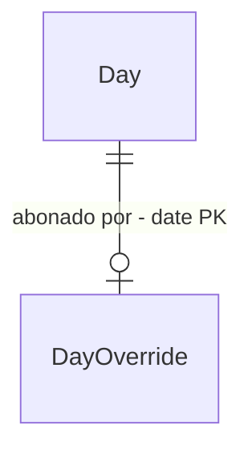

# Abono parcial

## Problem

Um abono hoje sempre zera a meta do dia. Quando só parte do dia é dispensada, como uma consulta
médica de 2h com atestado ou uma saída liberada pelo gestor, sobram duas opções erradas. Se eu não
abono nada, as horas dispensadas aparecem como "horas devendo" (−2h nesse exemplo). Se eu abono o
dia inteiro, tudo o que trabalhei vira extra (+6h). Nos dois casos o saldo fica errado na mesma
proporção, e hoje a "Saída para fechar 08:00" mostra um horário que não vale para esse dia.

Quando isso estiver pronto, um abono pode cobrir X horas de um dia útil, e a meta do dia passa a
ser a jornada menos X.

## Flow

Reaproveita `day_overrides`, `setDayOverride` e `targetFor`: o abono parcial é um abono comum com
uma quantidade de minutos, e o resto do cálculo (`summarizeDay`, `buildReport`, `groupByWeek`)
herda a meta reduzida sem mudanças.

1. `db()` (exists, `src/lib/db.ts`) - na primeira conexão, depois do `SCHEMA`, aplica as migrações pendentes segundo `settings.schema_version` (door 1). A migração 1 adiciona `day_overrides.minutes` (door 2).
2. `DayDialog` → `OverridePicker` (exists) - tipo de abono mais o campo "Horas abonadas" (`HH:MM`, vazio quer dizer dia inteiro)
3. `setDayOverride` (exists, `src/app/actions.ts`) - valida e chama `setOverride(date, kind, minutes)` (exists), cujo upsert passa a gravar `minutes`
4. `targetFor` (exists, `src/lib/hours.ts`) - em dia útil com `minutes`, a meta é `max(0, dailyMinutes − minutes)`
5. `summarizeDay` (exists) - o status `abonado` passa a valer só para abono de dia inteiro
6. out: card "Hoje", `DayDialog` e relatório mostram a meta reduzida e "Atestado de 02:00"

## Impact

| Front | What changes |
| --- | --- |
| domain | existing term: `abono` significava "meta 0h no dia". Agora significa "meta reduzida em M minutos, ou 0h quando M está vazio". Quem decide com base nisso hoje: `targetFor`, a regra `override && ... status = "abonado"` em `summarizeDay`, o texto "(dia abonado)" no card Hoje de `src/app/page.tsx` e `StatusBadge` em `src/components/format.tsx`. |
| domain | new term: `abono parcial`, um abono com `minutes` preenchido, que só vale para dia útil |
| stored data | migrate on read: as linhas existentes de `day_overrides` ficam com `minutes` NULL, que quer dizer dia inteiro, então nenhum saldo muda. A migração roda contra o banco do Turso em produção na primeira requisição depois do deploy. |
| stored data | `setOverride` precisa gravar `minutes = excluded.minutes` no `ON CONFLICT`, senão trocar um abono parcial por um de dia inteiro deixaria os minutos antigos na linha |
| docs | `README.md`, seção Regras, ganha a regra do abono parcial |

## Relations

One-way constraints: `day_overrides.minutes` nulo quer dizer dia inteiro, e preenchido tem de ser
positivo (door 2). Uma versão de esquema por banco em `settings.schema_version` (door 1). No
columns and no types here.

## Surface

None - nothing consumed outside. A assinatura da Server Action `setDayOverride` muda, mas o único
lugar que a chama é o `DayDialog`.

## Landing

| One-way door | Literal shape | Alternative rejected |
| --- | --- | --- |
| mecanismo de migração (primeiro do projeto, e o próximo item do roadmap, jornada por dia da semana, vai copiar) | lista ordenada `MIGRATIONS` em `db.ts`. Cada migração pendente roda num batch `write` junto com `INSERT ... ON CONFLICT (key) DO UPDATE` de `schema_version` = `<n>`. Se o batch falha, o código relê `schema_version` e segue quando o valor já é ≥ n (outra instância aplicou antes). | `ALTER TABLE` com erro "duplicate column" ignorado: depende do texto da mensagem e não serve para migrações cujo efeito não dá para detectar. `PRAGMA user_version`: não achei documentação garantindo suporte pelo Turso remoto. |
| coluna `day_overrides.minutes` | `ALTER TABLE day_overrides ADD COLUMN minutes INTEGER CHECK (minutes IS NULL OR minutes > 0)`, com NULL valendo dia inteiro | guardar a meta resultante em vez dos minutos abonados: mudar a jornada em Configurações deixaria a meta antiga congelada nos dias já abonados |

- Nothing else in this change is hard to reverse

## Criteria

### S1: Meta reduzida no cálculo (P1)

Um abono parcial de M minutos reduz a meta do dia útil em M, e o saldo acompanha.

**Acceptance Criteria**

1. WHEN um dia útil tem abono com `minutes` = 120 e a jornada é 08:00 THEN the system SHALL usar meta 06:00 para esse dia
2. IF a jornada atual é menor ou igual aos minutos abonados THEN the system SHALL usar meta 00:00, nunca negativa
3. IF um dia útil passado tem abono parcial e nenhuma batida THEN the system SHALL marcar o status `falta` e somar −(jornada − M) ao banco (ex.: −06:00)
4. WHEN um dia com abono parcial tem só pares fechados THEN the system SHALL marcar o status `ok`, e não `abonado`
5. The system SHALL manter meta 00:00 e status `abonado` para abono com `minutes` NULL (comportamento atual)
6. WHILE hoje tem abono parcial de 02:00 e entrada aberta às 08:00 sem outras batidas, com jornada 08:00, the system SHALL mostrar "Saída para fechar 06:00" com o valor 14:00

**Independent test:** abonar 02:00 como atestado num dia passado com 08:00–12:00 e 13:00–15:00 e conferir saldo do dia 00:00 no relatório.

### S2: Registrar e remover o abono parcial (P1)

O `DayDialog` permite informar quantas horas o abono cobre.

**Acceptance Criteria**

7. WHEN o usuário escolhe um tipo de abono com "Horas abonadas" = `02:00` num dia útil THEN the system SHALL gravar `minutes` = 120 e mostrar o toast "Atestado de 02:00 registrado." (com o rótulo do tipo escolhido)
8. WHEN o usuário escolhe um tipo de abono com "Horas abonadas" vazio THEN the system SHALL gravar `minutes` NULL e manter a mensagem atual "Dia marcado como <tipo>."
9. IF "Horas abonadas" não está no formato `HH:MM` ou vale `00:00` THEN the system SHALL recusar com "Horas abonadas devem estar no formato HH:MM." e não gravar
10. IF os minutos abonados são maiores ou iguais à jornada atual THEN the system SHALL recusar com "Abono parcial deve ser menor que a jornada de 08:00. Para o dia todo, deixe as horas em branco." (com a jornada atual) e não gravar
11. IF a data é sábado ou domingo e "Horas abonadas" está preenchido THEN the system SHALL recusar com "Fim de semana já tem meta de 0h." e não gravar
12. WHEN um dia com abono parcial passa a ter abono de dia inteiro THEN the system SHALL gravar `minutes` NULL na mesma linha
13. WHEN o usuário escolhe "Dia normal" num dia com abono parcial THEN the system SHALL remover a linha do abono

**Independent test:** no `DayDialog` de hoje, abonar 01:30 como folga e ver a meta mudar de 08:00 para 06:30 no card Hoje.

### S3: Mostrar o abono parcial (P2)

Fica visível que a meta do dia foi reduzida, e por quê.

**Acceptance Criteria**

14. WHEN hoje tem abono parcial THEN the system SHALL mostrar no card Hoje "Meta de 06:00 (atestado de 02:00)" no lugar de "(dia abonado)"
15. WHEN o `DayDialog` abre num dia com abono parcial THEN the system SHALL mostrar o tipo selecionado e "Horas abonadas" preenchido com `02:00`
16. WHEN o relatório lista um dia com abono parcial THEN the system SHALL mostrar o badge do tipo com a duração (ex.: "Atestado 02:00") ao lado do status do dia

**Independent test:** abrir o relatório do mês e encontrar o badge "Atestado 02:00" no dia abonado.

### S4: Migração do banco existente (P1)

O banco local e o do Turso ganham a coluna sem perder dados nem mudar o saldo.

**Acceptance Criteria**

17. WHEN o app conecta num banco sem `schema_version` THEN the system SHALL adicionar `day_overrides.minutes` e gravar `schema_version` = `1` no mesmo batch `write`
18. WHEN a migração 1 termina THEN the system SHALL manter todas as linhas existentes de `day_overrides` com `minutes` NULL e o saldo total igual ao de antes da migração
19. IF o batch da migração falha e a releitura de `schema_version` dá ≥ 1 THEN the system SHALL seguir com a conexão normalmente
20. IF o batch da migração falha e `schema_version` continua < 1 THEN the system SHALL propagar o erro, para que a próxima requisição tente de novo (comportamento atual de `db()`)

**Independent test:** copiar `data/ponto.db` atual, subir o app apontando para a cópia e conferir o mesmo saldo total, `schema_version` = 1 e a coluna nova.

## Out of scope

| Excluded | Why |
| --- | --- |
| Mais de um abono parcial no mesmo dia | `day_overrides.date` é chave primária. Dois motivos no mesmo dia somam-se à mão num abono só. |
| Abono por intervalo de horário (ex.: 14:00–16:00) | o que muda o saldo é a duração, e o intervalo não entra no cálculo |
| Abono parcial em fim de semana | a meta já é 0h |

## Assumptions

| Assumption | Chosen default | Rationale | Confirmed? |
| --- | --- | --- | --- |
| Tipos que aceitam abono parcial | os três (`feriado`, `folga`, `atestado`) | atestado cobre a consulta, folga cobre a saída liberada e feriado cobre o meio expediente, como na Quarta-feira de Cinzas | n |
| Abono parcial com a jornada alterada depois | os minutos abonados ficam fixos e a meta é recalculada com a jornada nova | o que a empresa dispensou foram as 2h, não uma fração do dia | n |
| Formato de entrada | `HH:MM`, igual a "Jornada diária" em Configurações | mantém o mesmo jeito de digitar duração que já existe no app | n |

**Open questions:** none - all resolved or logged above.

## Observable

| Surface | Decision | Landing |
| --- | --- | --- |
| screen `DayDialog` | estado sem abono | existing - "Dia normal" selecionado e campo vazio |
| screen `DayDialog` | error state | AC 9, AC 10, AC 11 (toast de erro via `useAction`, como já acontece) |
| screen `DayDialog` | loading state | existing - botões desabilitados enquanto `pending` |
| screen `DayDialog` | unauthorised | existing - `UNAUTHORIZED` em `setDayOverride` |
| screen `DayDialog` | destructive action confirms | existing - "Dia normal" remove sem confirmar (AC 13) |
| screen card Hoje | exibição do abono parcial | AC 14 |
| screen relatório | exibição do abono parcial | AC 16 |

## Sources

- `ROADMAP.md`, item "Abono parcial" - os exemplos (consulta de 2h, saída liberada) e a regra "reduz a meta daquele dia"
