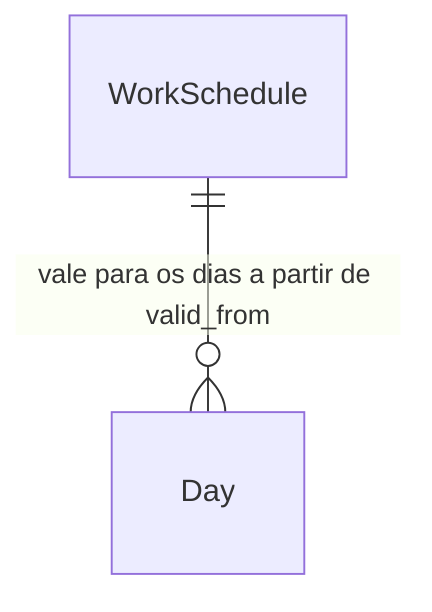

# Jornada por dia da semana

## Problem

O app só conhece uma jornada diária, igual de segunda a sexta, e sábado e domingo valem sempre 0h.
Quem trabalha 9h de segunda a quinta e 4h na sexta vê −1h todo dia de segunda a quinta e +4h toda
sexta. O saldo da semana fecha, mas o de cada dia está errado, e a "Saída para fechar" mostra o
horário errado em todos os dias. Quem tem escala de 44h, com 4h no sábado, não tem como
registrar isso: o sábado conta inteiro como extra, e um sábado sem batidas nunca aparece como
falta.

Além disso, mudar a jornada em Configurações recalcula todo o histórico. Uma troca de contrato no
meio do banco reescreve o saldo de meses que já estavam certos.

O `ROADMAP.md` traz o exemplo de 9h de segunda a quinta e 4h na sexta, e não traz números.

Quando isso estiver pronto, cada dia da semana tem sua jornada, e cada jornada vale a partir de
uma data. Os dias anteriores continuam com a jornada que valia para eles.

## Flow

Reaproveita `targetFor`, `summarizeDay` e o mecanismo de `MIGRATIONS` (AD-001): o resto do
cálculo continua recebendo a jornada de um dia em minutos, e só muda de onde esse número vem.

1. `db()` (exists, `src/lib/db.ts`) - a migração 2 cria `work_schedules` (door 1) e copia a jornada atual para a linha "desde o início" (door 2), no mesmo batch do `schema_version`
2. `loadBank` (exists, `src/lib/data.ts`) - lê as jornadas junto com as configurações e entrega a lista a `buildReport`
3. `buildReport` (exists, `src/lib/hours.ts`) - para cada data, escolhe a jornada com o maior `valid_from` ≤ data e passa os minutos daquele dia da semana a `summarizeDay` (exists)
4. `targetFor` (exists) - a meta é a jornada do dia. Deixa de olhar `isWeekend`, e o abono continua zerando ou reduzindo a meta como hoje.
5. Configurações (`src/app/config/page.tsx`, exists) - lista as jornadas e o formulário de 7 campos chama as Server Actions de salvar e remover (`src/app/actions.ts`, exists)
6. out: painel, relatório e "Saída para fechar" usam a meta do dia. A meta da semana soma a jornada dos dias que faltam.

## Impact

| Front | What changes |
| --- | --- |
| domain | existing term: `dia útil` significava "segunda a sexta". Agora significa "dia com jornada maior que 0". Quem decide com base nisso hoje: `isWeekend` em `targetFor`, a recusa de abono parcial em fim de semana em `setDayOverride`, `futureWeekdays` na meta da semana em `src/app/page.tsx` e o texto de Configurações. |
| domain | existing term: `jornada` era um número (`settings.daily_minutes`). Agora é uma tabela de 7 valores por vigência. Quem lê hoje: `getSettings`, `updateSettings`, `setDayOverride` (limite do abono parcial), `page.tsx` (dia de hoje sem resumo e meta da semana) e `SettingsForm`. |
| domain | status `folga-semanal` (badge "Fim de semana") passa a valer para qualquer dia com jornada 0. Num dia de semana com jornada 0, o badge diz "Sem jornada". |
| stored data | backfill now: a migração 2 cria a linha "desde o início" com a jornada atual de segunda a sexta e 0 no sábado e no domingo, então nenhum saldo muda. Roda contra o Turso em produção na primeira requisição depois do deploy. |
| stored data | `settings.daily_minutes` fica no banco e deixa de ser lido e gravado. Se o deploy for revertido, o código antigo continua lendo o valor de antes da migração. |
| feriados | um feriado num sábado com jornada passa a zerar uma meta de verdade. Antes ele não mudava nada. |
| abono parcial | o limite "menor que a jornada" passa a usar a jornada daquele dia, e não a jornada única |
| docs | `README.md`, seção Regras: troca "Jornada padrão de 8h por dia útil (segunda a sexta)" pela regra nova |

## Relations

One-way constraints: `valid_from` é único (door 1). Sempre existe uma linha com `valid_from` =
`0000-01-01`, que quer dizer "desde o início" e não pode ser removida (door 2). Cada dia da semana
vale de 0 a 1440 minutos. No columns and no types here.

## Surface

None - nothing consumed outside. As Server Actions mudam de assinatura, mas o único lugar que as
chama é o `SettingsForm`.

## Landing

| One-way door | Literal shape | Alternative rejected |
| --- | --- | --- |
| tabela de jornadas por vigência (migração 2) | `CREATE TABLE work_schedules (valid_from TEXT PRIMARY KEY, d0 INTEGER NOT NULL CHECK (d0 BETWEEN 0 AND 1440), ..., d6 INTEGER NOT NULL CHECK (d6 BETWEEN 0 AND 1440))`, com `d0` = domingo, como `getDay()` | uma linha por dia da semana com chave `(valid_from, weekday)`: salvar uma jornada são 7 linhas que precisam entrar juntas, e uma linha faltando não tem significado. JSON em `settings`: sem `CHECK`, e cada leitura precisa validar o texto. |
| linha "desde o início" | `valid_from = '0000-01-01'`, criada pela migração 2 com `INSERT INTO work_schedules SELECT '0000-01-01', 0, m, m, m, m, m, 0 FROM (SELECT coalesce((SELECT CAST(value AS INTEGER) FROM settings WHERE key = 'daily_minutes'), 480) AS m)`. As actions recusam removê-la. | "a primeira vigência vale também para trás": remover a primeira linha mudaria em silêncio a meta de todos os dias antes da segunda |

- Esse modelo de vigência vira decisão de projeto (AD-003 em `.specs/STATE.md`) quando o plano for aprovado: outra regra que mude com o tempo, como o prazo de compensação, deve copiar a forma.
- Nothing else in this change is hard to reverse

## Criteria

### S1: Meta do dia pela jornada em vigor (P1)

**Acceptance Criteria**

1. WHEN a jornada em vigor tem 09:00 na segunda e 04:00 na sexta THEN the system SHALL usar meta 09:00 numa segunda e 04:00 numa sexta
2. WHEN a jornada em vigor tem 04:00 no sábado THEN the system SHALL usar meta 04:00 no sábado, e um sábado passado sem batidas fica `falta` com −04:00 no banco
3. WHEN um dia da semana tem jornada 00:00 e o dia não tem batidas THEN the system SHALL marcar o status `folga-semanal`, com o badge "Fim de semana" no sábado e no domingo e "Sem jornada" nos outros dias
4. WHEN existem as jornadas "desde o início" (08:00 de segunda a sexta) e "a partir de 2026-10-19" (09:00 de segunda a quinta, 04:00 na sexta) THEN the system SHALL usar meta 08:00 na sexta 2026-10-16 e 04:00 na sexta 2026-10-23
5. The system SHALL escolher, para cada data, a jornada com o maior `valid_from` menor ou igual à data
6. WHILE hoje é quarta-feira e a jornada em vigor tem 09:00 na quinta e 04:00 na sexta the system SHALL somar 13:00 desses dois dias à meta da "Semana atual"
7. WHEN um dia com jornada tem abono de dia inteiro THEN the system SHALL usar meta 00:00, e com abono parcial de M minutos, `max(0, jornada do dia − M)` (comportamento atual, agora com a jornada do dia)

**Independent test:** cadastrar 09:00 seg-qui e 04:00 sex a partir da próxima segunda e conferir que o relatório desta semana não muda e o da próxima mostra meta 04:00 na sexta.

### S2: Cadastrar e remover jornadas (P1)

**Acceptance Criteria**

8. WHEN Configurações abre THEN the system SHALL listar as jornadas da mais recente para a mais antiga, com a data de início ("Desde o início" na primeira), os 7 dias em `HH:MM` e o total da semana
9. WHEN o usuário salva os 7 campos com "Vale a partir de" = 2026-10-19 THEN the system SHALL gravar a jornada com `valid_from` 2026-10-19 e responder "Jornada salva a partir de 19/10/2026."
10. WHEN o usuário salva com "Vale a partir de" vazio THEN the system SHALL substituir a jornada "desde o início" e responder "Jornada desde o início salva."
11. WHEN já existe uma jornada com a mesma data de início THEN the system SHALL substituí-la, sem criar uma segunda linha
12. IF algum dos 7 campos não está no formato `HH:MM` ou passa de `24:00` THEN the system SHALL recusar com "Jornada de <dia> deve estar no formato HH:MM, até 24:00." e não gravar
13. IF os 7 campos valem `00:00` THEN the system SHALL recusar com "Informe a jornada de pelo menos um dia." e não gravar
14. WHEN o usuário remove a jornada de 19/10/2026 THEN the system SHALL apagar a linha e responder "Jornada de 19/10/2026 removida.", e os dias a partir dela voltam a usar a jornada anterior
15. IF o usuário tenta remover a jornada "desde o início" THEN the system SHALL recusar com "A jornada desde o início não pode ser removida." e não apagar
16. WHEN o formulário abre THEN the system SHALL preencher os 7 campos com a jornada em vigor hoje e "Vale a partir de" com a data de hoje

**Independent test:** em Configurações, salvar 04:00 na sexta a partir de hoje, ver a linha nova na lista e removê-la.

### S3: Abono parcial com a jornada do dia (P1)

**Acceptance Criteria**

17. IF os minutos de um abono parcial são maiores ou iguais à jornada daquele dia THEN the system SHALL recusar com "Abono parcial deve ser menor que a jornada de 04:00. Para o dia todo, deixe as horas em branco." com a jornada do dia
18. IF a data é sábado ou domingo com jornada 00:00 e "Horas abonadas" está preenchido THEN the system SHALL recusar com "Fim de semana já tem meta de 0h." (mensagem atual)
19. IF a data é um dia de segunda a sexta com jornada 00:00 e "Horas abonadas" está preenchido THEN the system SHALL recusar com "Este dia não tem jornada, a meta já é 0h."
20. WHEN a data é um sábado com jornada 04:00 e "Horas abonadas" = `01:00` THEN the system SHALL gravar o abono parcial, e a meta do dia fica 03:00

**Independent test:** com 04:00 no sábado, abonar 01:00 num sábado e ver meta 03:00 no relatório.

### S4: Migração do banco existente (P1)

**Acceptance Criteria**

21. WHEN o app conecta num banco com `schema_version` = 1 e `daily_minutes` = 450 THEN the system SHALL criar `work_schedules` com uma linha `0000-01-01` de 450 de segunda a sexta e 0 no sábado e no domingo, e gravar `schema_version` = 2, no mesmo batch
22. IF `daily_minutes` não existe em `settings` THEN the system SHALL criar a linha "desde o início" com 480 de segunda a sexta
23. WHEN a migração 2 termina THEN the system SHALL manter o saldo total igual ao de antes da migração
24. IF o batch da migração 2 falha THEN the system SHALL seguir a regra atual de `applyMigrations`: continuar se outra instância já gravou `schema_version` ≥ 2 e propagar o erro caso contrário

**Independent test:** copiar `data/ponto.db`, subir o app apontando para a cópia e conferir o mesmo saldo total, `schema_version` = 2 e a jornada "desde o início" igual à jornada antiga.

## Out of scope

| Excluded | Why |
| --- | --- |
| Jornada diferente por semana (escala 12x36, semanas alternadas) | o roadmap pede por dia da semana. Escala em ciclo precisa de outro modelo. |
| Horário previsto de entrada e saída por dia | só a duração entra no cálculo do saldo |
| Editar uma vigência existente pela lista | salvar com a mesma data já substitui (AC 11) |

## Assumptions

| Assumption | Chosen default | Rationale | Confirmed? |
| --- | --- | --- | --- |
| Sábado e domingo podem ter jornada | sim, os 7 dias, e 0 quer dizer que não trabalha | escolhido pelo usuário | y |
| Mudança de jornada e o histórico | cada jornada vale a partir de uma data, e os dias anteriores mantêm a antiga | escolhido pelo usuário | y |
| Data padrão do formulário | hoje | o caso comum é "minha jornada mudou a partir de agora". Em branco continua disponível para corrigir tudo. | n |
| Jornada com data futura | permitida, e só passa a valer naquela data | serve para registrar com antecedência uma mudança de contrato já combinada | n |
| Remover uma jornada | sem confirmação, como "Dia normal" no abono | desfaz salvando de novo com a mesma data | n |
| Limite de cada dia | de 00:00 a 24:00, como a validação atual da jornada | mantém a regra que já existe em `updateSettings` | n |

**Open questions:** none - all resolved or logged above.

## Observable

| Surface | Decision | Landing |
| --- | --- | --- |
| screen Configurações, lista de jornadas | empty state | n/a - a linha "desde o início" sempre existe (door 2) |
| screen Configurações, lista de jornadas | ordenação | AC 8 |
| screen Configurações, formulário | valores iniciais | AC 16 |
| screen Configurações, formulário | error state | AC 12, AC 13, AC 15 (toast de erro via `useAction`) |
| screen Configurações, formulário | loading state | existing - botão desabilitado com "Salvando…" enquanto `pending` |
| screen Configurações | unauthorised | existing - `UNAUTHORIZED` nas Server Actions |
| screen Configurações | destructive action confirms | AC 14 sem confirmação (assumption acima) |
| screen relatório e painel | badge de dia sem jornada | AC 3 |
| screen `DayDialog` | erro do abono parcial | AC 17, AC 18, AC 19 |
| document README, Regras | regra nova da jornada | Impact, linha docs |

## Sources

- `ROADMAP.md`, item "Jornada diferente por dia da semana" - o exemplo de 9h seg-qui e 4h sex
- Respostas do usuário nesta sessão (2026-10-16): os 7 dias podem ter jornada, e cada jornada vale a partir de uma data
