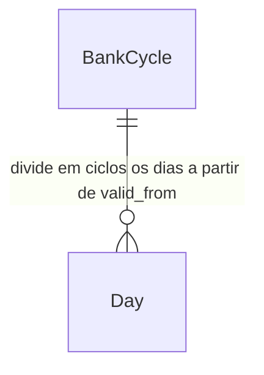

# Prazo de compensação do banco

## Problem

O saldo do app acumula desde o início do banco e nunca fecha. Na empresa, o banco fecha a cada N
meses: o que sobrou é pago ou descontado e o saldo volta a zero. Depois do primeiro fechamento, o
saldo do app e o da empresa deixam de bater, e a diferença é o saldo de fechamento do ciclo
anterior. O único jeito de corrigir hoje é mudar "Início do banco de horas" para o primeiro dia do
ciclo, e com isso o relatório perde os dias anteriores.

O app também não mostra quando o ciclo fecha. Quem tem horas a mais não sabe até quando pode
folgar para usá-las, e quem está devendo não sabe até quando precisa compensar antes de o
desconto sair no salário.

O `ROADMAP.md` diz "Muitas empresas zeram ou pagam o banco a cada 4 meses" e pede "Mostrar quanto
vence e quando". Não traz números.

Quando isso estiver pronto, o painel mostra quanto vence e em que data, o saldo volta a 00:00 no
primeiro dia de cada ciclo, e o relatório guarda o saldo com que cada ciclo fechou.

## Flow

Reaproveita `buildReport`, que já calcula o acumulado dia a dia, o modelo de vigência da jornada
(AD-003) e o mecanismo de `MIGRATIONS` (AD-001). O resto do app continua lendo `accumulated` e
`total`, que passam a ser o saldo do ciclo.

1. `db()` (exists, `src/lib/db.ts`) - a migração 3 cria `bank_cycles` (door 1) com a linha "desde o início" sem prazo (door 2), no mesmo batch do `schema_version`
2. `loadBank` (exists, `src/lib/data.ts`) - lê as regras de ciclo junto com as jornadas e entrega as duas listas a `buildReport`
3. `buildReport` (exists, `src/lib/hours.ts`) - pergunta a `cycleFor` (new, no door - placement per conventions) em que ciclo está cada dia e, no primeiro dia de um ciclo, começa o acumulado em 00:00. `closedCycles` (new, no door) lê os dias prontos e devolve cada ciclo fechado com início, fim e saldo de fechamento.
4. Painel (`src/app/page.tsx`, exists) - abaixo do saldo, mostra quanto vence e quando, pelo fim do período em vigor hoje. A frase do gráfico mede a variação desde o início do período.
5. Relatório (`src/app/relatorio/page.tsx`, exists) - o card do banco mostra desde quando o ciclo conta, e um card lista os ciclos fechados com o saldo de fechamento
6. Configurações (`src/app/config/page.tsx`, exists) - lista as regras e o formulário chama as Server Actions de salvar e remover (`src/app/actions.ts`, exists)
7. out: painel, relatório, gráfico e CSV mostram o saldo do ciclo em vigor

## Impact

| Front | What changes |
| --- | --- |
| domain | new term: `ciclo` - intervalo entre dois fechamentos do banco. Começa no `valid_from` de uma regra ou a cada N meses depois dele, e termina no dia anterior ao próximo início. Vive em `src/lib/hours.ts`. |
| domain | new term: `saldo de fechamento` - o acumulado no último dia de um ciclo, que é o que vence (pago ou descontado) |
| domain | existing term: `accumulated` (e `total`, o acumulado de hoje) era o saldo desde o início do banco. Agora é o saldo desde o início do ciclo. Quem lê hoje: o saldo grande e "Saída para zerar o banco" no painel, "Banco total" no relatório, `balanceSeries` (gráfico), a coluna de acumulado de `reportCsv` (CSV). Sem nenhuma regra com prazo, o valor é o mesmo de hoje. |
| gráfico | a linha cai para perto de 00:00 no primeiro dia de um ciclo. É o que aconteceu com o banco, então a linha continua como está. Só a frase "Subiu/Caiu" muda de referência. |
| CSV | a coluna de acumulado volta a 00:00 no primeiro dia de um ciclo, igual ao relatório |
| stored data | backfill now: a migração 3 cria `bank_cycles` com uma linha "desde o início" sem prazo, então nenhum saldo muda até o usuário cadastrar um ciclo. Roda contra o Turso em produção na primeira requisição depois do deploy. |
| docs | `README.md`, seção Regras: acrescenta o prazo de compensação e o zeramento no fechamento |

## Relations

One-way constraints: `valid_from` é único (door 1). Sempre existe a linha `valid_from` =
`0000-01-01`, sem prazo, que não pode ser removida nem alterada (door 2). O prazo vai de 0 (sem
prazo) a 12 meses. No columns and no types here.

## Surface

None - nothing consumed outside. As Server Actions novas só são chamadas pelo formulário de
Configurações.

## Landing

| One-way door | Literal shape | Alternative rejected |
| --- | --- | --- |
| tabela de regras de ciclo por vigência (migração 3) | `CREATE TABLE bank_cycles (valid_from TEXT PRIMARY KEY, months INTEGER NOT NULL CHECK (months BETWEEN 0 AND 12))`, com 0 = sem prazo | chaves `cycle_start` e `cycle_months` em `settings`: mudar o prazo moveria os fechamentos que já aconteceram e reescreveria o saldo de meses passados, o que AD-003 proíbe. Coluna de prazo em `work_schedules`: toda mudança de jornada viraria um fechamento do banco. |
| linha "desde o início" | `INSERT INTO bank_cycles (valid_from, months) VALUES ('0000-01-01', 0)` na migração 3. As actions recusam removê-la e recusam salvar com essa data. | linha editável com prazo: os ciclos contariam a partir do ano 0, uma data que não corresponde a nenhum acordo |

- Toda regra além da "desde o início" começa um ciclo no seu `valid_from`, inclusive uma regra sem prazo. Isso é cálculo e não é persistido, mas é o que outras features vão ler como "saldo do banco": quando o plano for aprovado, vira AD-004 em `.specs/STATE.md` ("o saldo do banco é o acumulado do ciclo em vigor; cada `valid_from` de `bank_cycles` e cada N meses depois dele começam em 00:00").
- Nothing else in this change is hard to reverse

## Criteria

### S1: Ciclos e zeramento no cálculo do saldo (P1)

O acumulado volta a 00:00 no primeiro dia de cada ciclo, e cada ciclo fechado tem um saldo de fechamento.

**Acceptance Criteria**

1. The system SHALL começar um ciclo no `valid_from` de cada regra, exceto a "desde o início"
2. WHERE uma regra tem prazo de N > 0 meses the system SHALL começar um novo ciclo em `addMonths(valid_from, k × N)` para k = 1, 2, 3…, sempre contado a partir do `valid_from` e nunca do ciclo anterior
3. WHEN a regra é de 4 meses a partir de 2026-01-31 THEN the system SHALL começar os ciclos em 2026-01-31, 2026-05-31, 2026-09-30 e 2027-01-31
4. The system SHALL terminar cada ciclo no dia anterior ao próximo início, seja ele o próximo ciclo da mesma regra ou o `valid_from` da regra seguinte
5. WHEN um dia é o primeiro de um ciclo e não é o primeiro dia do banco THEN the system SHALL começar o acumulado desse dia em 00:00 e somar só o saldo do próprio dia
6. WHEN a regra é de 4 meses a partir de 2026-05-01, o acumulado em 2026-08-31 é +03:00 e 2026-09-01 tem saldo +00:30 THEN the system SHALL mostrar acumulado +00:30 em 2026-09-01 e registrar o ciclo de 2026-05-01 a 2026-08-31 com saldo de fechamento +03:00
7. WHEN só existe a regra "desde o início" sem prazo THEN the system SHALL calcular o acumulado de cada dia igual ao cálculo atual, sem nenhum zeramento
8. WHEN o banco começa em 2026-06-15 e o ciclo em vigor começou em 2026-05-01 THEN the system SHALL tratar 2026-06-15 como o início desse ciclo dentro do banco
9. The system SHALL usar como saldo do banco no painel, no relatório, no gráfico e no CSV o acumulado do ciclo em vigor

**Independent test:** cadastrar ciclos de 4 meses a partir do primeiro dia de um mês que já passou e ver o acumulado do relatório voltar a 00:00 nesse dia.

### S2: Painel mostra quanto vence e quando (P1)

**Acceptance Criteria**

10. WHILE o ciclo em vigor hoje termina em 2026-12-31, hoje é 2026-10-16 e o saldo é +05:30 the system SHALL mostrar abaixo do saldo "+05:30 vencem em 31/12/2026 (daqui a 76 dias)."
11. WHILE o ciclo em vigor hoje tem fim e o saldo é negativo the system SHALL mostrar "−02:00 a compensar até 31/12/2026 (daqui a 76 dias)." com o saldo e a data do fim
12. WHILE o ciclo em vigor hoje tem fim e o saldo é 00:00 the system SHALL mostrar "O ciclo fecha em 31/12/2026 (daqui a 76 dias)." com a data do fim
13. WHEN o fim do ciclo é amanhã THEN the system SHALL trocar "(daqui a N dias)" por "(amanhã)", e WHEN o fim é hoje, por "(hoje)"
14. WHILE o ciclo em vigor hoje não tem fim (regra sem prazo e nenhuma regra começa depois de hoje) the system SHALL não mostrar a linha de vencimento
15. WHILE existe uma regra que começa depois de hoje the system SHALL usar como fim do ciclo em vigor o dia anterior ao `valid_from` dela, se for antes do fim pelo prazo
16. WHEN o ciclo em vigor começou dentro da janela de 56 dias do gráfico THEN the system SHALL calcular "Subiu/Caiu" a partir do primeiro dia do ciclo, e a frase diz "desde" a data desse dia

**Independent test:** com ciclos de 4 meses a partir de 2026-09-01, abrir o painel e ver "vencem em 31/12/2026".

### S3: Relatório guarda os ciclos fechados (P1)

**Acceptance Criteria**

17. WHEN o relatório abre e o ciclo em vigor começou depois do início do banco THEN the system SHALL rotular o card do saldo "Banco do ciclo (desde 01/09/2026)" com o início do ciclo
18. WHEN o relatório abre e o ciclo em vigor começou no início do banco ou antes THEN the system SHALL manter o rótulo atual "Banco total (desde <início do banco>)"
19. WHEN pelo menos um ciclo terminou antes de hoje dentro do banco THEN the system SHALL mostrar o card "Ciclos fechados" com uma linha por ciclo, do mais recente para o mais antigo, no formato "01/05/2026 a 31/08/2026" e o saldo de fechamento com sinal
20. IF nenhum ciclo terminou antes de hoje dentro do banco THEN the system SHALL não mostrar o card "Ciclos fechados"
21. The system SHALL mostrar o card "Ciclos fechados" igual em qualquer período escolhido no relatório (semana, mês ou todo o período)

**Independent test:** com um ciclo já fechado, abrir o relatório e conferir a linha do ciclo com o mesmo valor que o acumulado tinha no último dia dele.

### S4: Cadastrar e remover regras em Configurações (P1)

**Acceptance Criteria**

22. WHEN Configurações abre THEN the system SHALL mostrar o card "Prazo de compensação" com as regras da mais recente para a mais antiga, cada uma com "Desde o início" ou "A partir de dd/MM/yyyy" e "Sem prazo", "Ciclos de 1 mês" ou "Ciclos de N meses"
23. WHEN o usuário salva prazo 4 com "A partir de" = 2026-09-01 THEN the system SHALL gravar a regra e responder "Prazo salvo: ciclos de 4 meses a partir de 01/09/2026."
24. WHEN o usuário salva "Sem prazo" com "A partir de" = 2026-09-01 THEN the system SHALL gravar a regra com prazo 0 e responder "Prazo salvo: sem prazo a partir de 01/09/2026."
25. WHEN já existe uma regra com a mesma data THEN the system SHALL substituí-la, sem criar uma segunda linha
26. IF "A partir de" está vazio, não é uma data `yyyy-MM-dd` válida ou é 0000-01-01 THEN the system SHALL recusar com "Informe a data de início do ciclo." e não gravar
27. IF o prazo não é um inteiro de 0 a 12 THEN the system SHALL recusar com "Escolha um prazo de 1 a 12 meses, ou sem prazo." e não gravar
28. WHEN o usuário remove a regra de 01/09/2026 THEN the system SHALL apagar a linha e responder "Regra de 01/09/2026 removida.", e os dias a partir dela voltam a seguir a regra anterior
29. IF o usuário tenta remover a regra "desde o início" THEN the system SHALL recusar com "A regra desde o início não pode ser removida." e não apagar
30. The system SHALL não mostrar o botão de remover na linha "desde o início"
31. WHEN o formulário abre THEN the system SHALL preencher o prazo com o da regra em vigor hoje (4 se ela for sem prazo) e "A partir de" com o primeiro dia do mês atual

**Independent test:** em Configurações, salvar ciclos de 4 meses a partir de 01/09/2026, ver a linha nova e removê-la.

### S5: Migração do banco existente (P1)

**Acceptance Criteria**

32. WHEN o app conecta num banco com `schema_version` = 2 THEN the system SHALL criar `bank_cycles` com a linha (`0000-01-01`, 0) e gravar `schema_version` = 3, no mesmo batch
33. WHEN a migração 3 termina THEN the system SHALL manter o acumulado de todos os dias igual ao de antes da migração
34. IF o batch da migração 3 falha THEN the system SHALL seguir a regra atual de `applyMigrations`: continuar se outra instância já gravou `schema_version` ≥ 3 e propagar o erro caso contrário

**Independent test:** copiar `data/ponto.db`, subir o app apontando para a cópia e conferir o mesmo saldo, `schema_version` = 3 e a regra "Desde o início · Sem prazo" em Configurações.

## Out of scope

| Excluded | Why |
| --- | --- |
| Vencimento por hora (cada hora extra vence N meses depois do dia em que foi feita) | o usuário escolheu ciclo fixo |
| Pagamento parcial no fechamento (a empresa paga parte e o resto continua) | precisaria de um ajuste manual do saldo, que o app não tem |
| Valor em reais e adicional de hora extra | o app conta horas, não salário |
| Ciclos fechados no CSV | o CSV exporta dias. O saldo de fechamento é o acumulado do último dia do ciclo, que já está na exportação. |
| Notificação perto do vencimento | é o mesmo trabalho do "Lembrete de saída" no roadmap |

## Assumptions

| Assumption | Chosen default | Rationale | Confirmed? |
| --- | --- | --- | --- |
| Modelo do prazo | ciclo fixo de N meses a partir de uma data | escolhido pelo usuário | y |
| O que acontece no fechamento | o acumulado volta a 00:00 no primeiro dia do ciclo seguinte, e o relatório guarda o saldo de fechamento | escolhido pelo usuário | y |
| Prazo máximo | 12 meses | a CLT (art. 59, §2º) limita o banco por acordo coletivo a um ano | n |
| Mudar a regra no meio de um ciclo | o ciclo em andamento fecha no dia anterior à regra nova (AC 4) | uma regra nova costuma vir com um acerto do banco, e AD-003 pede que a mudança não reescreva o passado | n |
| Regra "sem prazo" com data | também começa um ciclo novo nessa data | deixa uma regra só: toda data de início é um fechamento. Quem quer só encerrar os ciclos sem zerar não tem como, mas esse caso não apareceu. | n |
| Valores iniciais do formulário | prazo da regra em vigor (4 se for sem prazo) e o primeiro dia do mês atual | o roadmap cita 4 meses, e ciclos costumam começar no dia 1 | n |
| Remover uma regra | sem confirmação, como remover uma jornada | desfaz salvando de novo com a mesma data | n |
| Dia de hoje no fim do ciclo | o ciclo de hoje fecha no fim do dia, e "vencem" usa o saldo atual, que já não inclui o que falta de hoje | é o saldo que o painel já mostra hoje | n |

**Open questions:** none - all resolved or logged above.

## Observable

| Surface | Decision | Landing |
| --- | --- | --- |
| screen painel, linha de vencimento | estados por sinal do saldo | AC 10, AC 11, AC 12 |
| screen painel, linha de vencimento | sem prazo (vazio) | AC 14 |
| screen painel, linha de vencimento | proximidade do fim | AC 13 |
| screen painel, gráfico | referência da frase "Subiu/Caiu" | AC 16 |
| screen relatório, card "Ciclos fechados" | empty state | AC 20 |
| screen relatório, card "Ciclos fechados" | ordenação | AC 19 |
| screen relatório, card do saldo | rótulo | AC 17, AC 18 |
| screen Configurações, lista de regras | empty state | n/a - a linha "desde o início" sempre existe (door 2) |
| screen Configurações, lista de regras | ordenação | AC 22 |
| screen Configurações, formulário | valores iniciais | AC 31 |
| screen Configurações, formulário | error state | AC 26, AC 27, AC 29 (toast de erro via `useAction`) |
| screen Configurações, formulário | loading state | existing - botão desabilitado com "Salvando…" enquanto `pending` |
| screen Configurações | unauthorised | existing - `UNAUTHORIZED` nas Server Actions |
| screen Configurações | destructive action confirms | AC 28 sem confirmação (assumption acima) |
| document README, Regras | regra do prazo de compensação | Impact, linha docs |

## Sources

- `ROADMAP.md`, item "Prazo de compensação do banco" - zerar ou pagar a cada 4 meses, mostrar quanto vence e quando
- Respostas do usuário nesta sessão (2026-10-16): ciclo fixo, e o saldo zera no fechamento
- `.specs/STATE.md`, AD-003 - regra que muda com o tempo é guardada por vigência
